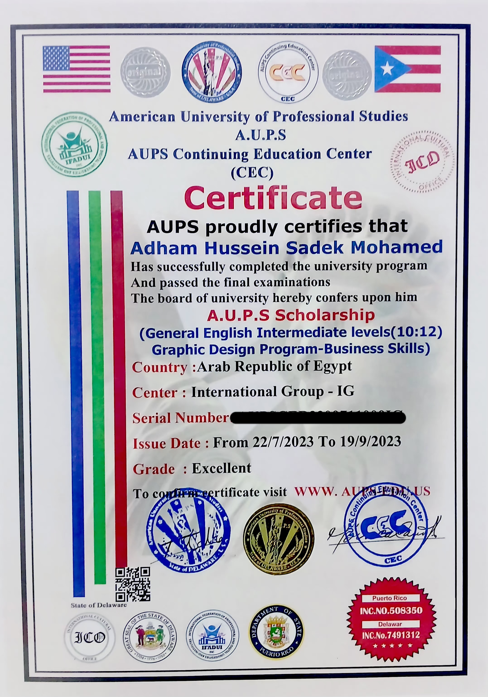
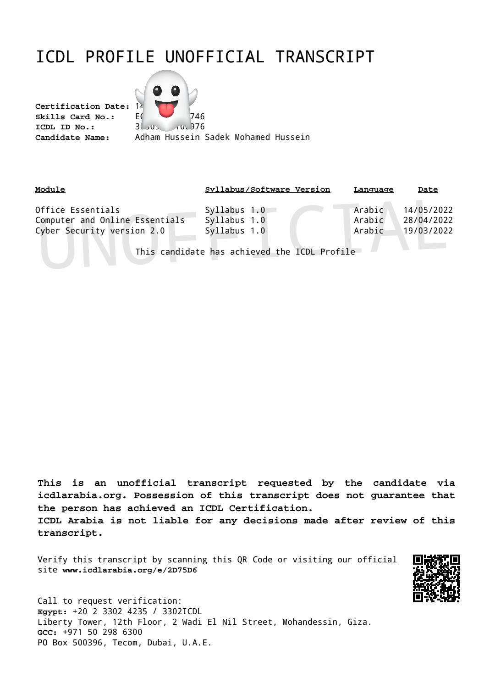

```bash
root@adham:~# whoami
4dham | Aspiring Penetration Tester| PNPT in Progress | Network & AD Security Enthusiast

root@adham:~# cat about.txt
I'm a cybersecurity student from Damietta, Egypt, focused on Offensive Security.
Currently grinding through TCM Security's PT path.
```

### 🌐 Portfolio: [4dham.github.io](https://4dham.github.io)
### 💼 LinkedIn: [Adham Hussein](https://www.linkedin.com/in/adham-hussein-296139440)
### 📫 Contact: a71148115@gmail.com

---


🛠️ What I'm Building
- **whale-analyzer** - DNS tracker to hunt ad companies and privacy leaks `Python | DNS`
- **PT Lab Writeups** ### 📝 Latest: [TryHackMe Writeups - Top 8%](https://github.com/4dham/tryhackme-writeups) - My live Offensive journey - Documenting my practical learning journey
- **Port Scanner (WIP)** - Next project while learning networking
---
## Certificates (2021-2023)

### 🎓 AUPS Scholarship 2023 - American University

- **American University of Professional Studies**
- Programs: English Intermediate (10:12) + Business Skills
- Grade: Excellent / Very Good (2023)
- REG NO: 94954 - International Group IG

### 🛡️ New ICDL V.6 - ICDL Arabia - Certified

- **Teba Training Center - ICDL Arabia**
- **Verified:** 14/05/2022 - Skills Card: EGT 200 334746 (Redacted for security)
- Modules:
    - Cyber Security 2.0 - Syllabus 1.0
    - Computer & Online Essentials - 28/04/2022
    - Office Essentials - 14/05/2022
- Verify at: icdlarabia.org
---
🎯 Current Focus
```
> Learning: Active Directory, Cloud, Python for Security
> Practicing: TryHackMe, TCM Labs
> Goal: PNPT Certified -> Junior Pentester Role
> Location: Damietta, Egypt [OPEN TO INTERNSHIPS]
```

📊 GitHub Stats
Learning in public - Every commit is a step forward.
---
"The quieter you become, the more you are able to hear" - Focus, Learn, Pwn
